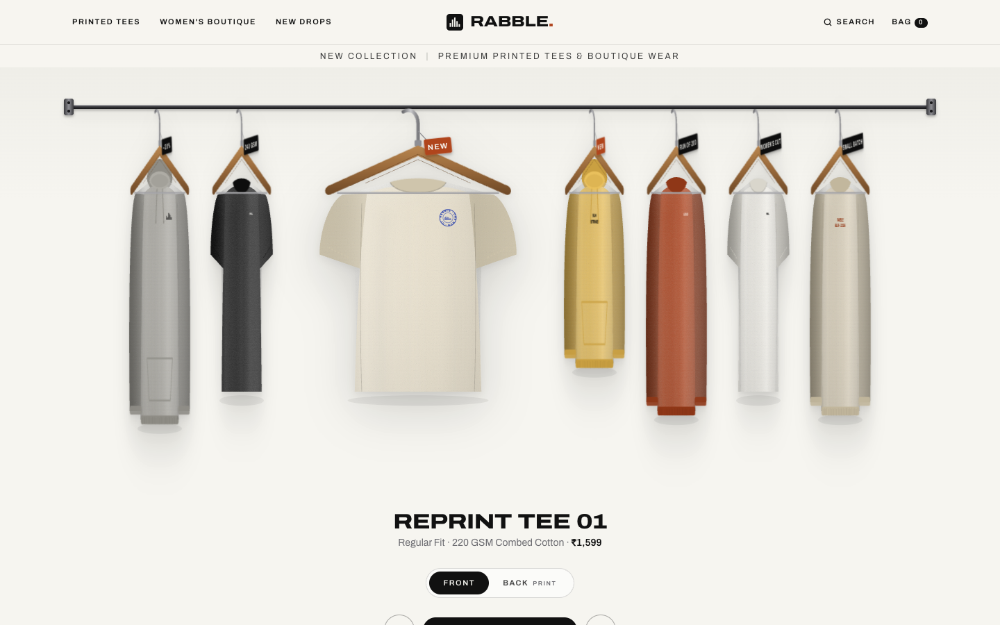
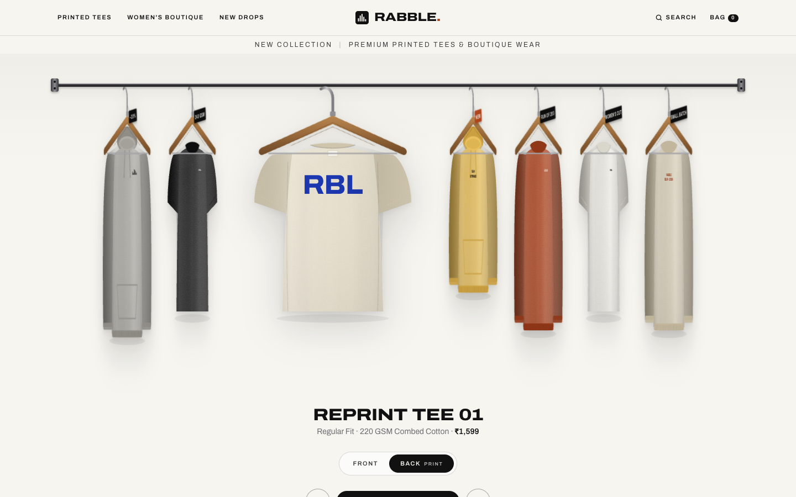
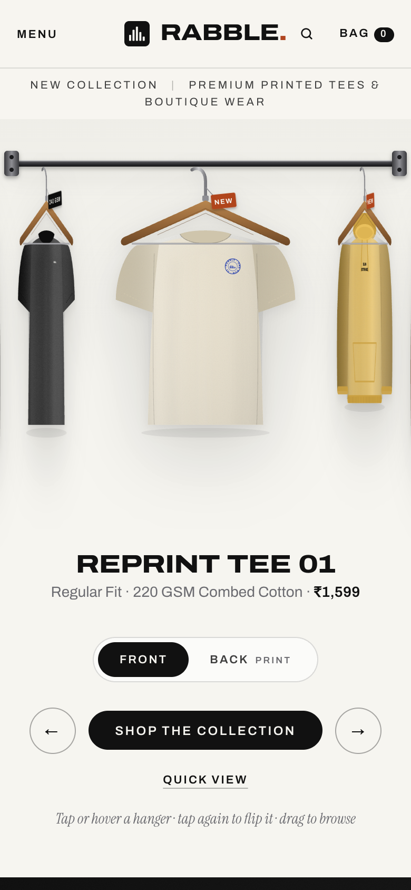

# Rack hero integration notes

_The pull-request write-up from the Fable 5 session that moved the garment-rack hero onto Phase-2 `main` (commit `2ad8b98`, originally `2a60f0a`). Kept for its decisions and acceptance numbers; the motion port and filters came later (`4c70ee6`)._

## Garment-rack hero on current `main`

Integrates the garment-rack hero session (patch `e3f88dc`, written against `4e6e01d`) onto `main` at `a3e4eb2`, keeping all of the Phase-2 work: `/brand`, `/about`, `/drop`, `/lookbook`, waitlist API, legal pages, SEO, the `content/` catalogue and the fonts.

| Desktop, 1440 | Back print | Mobile, 390 |
| --- | --- | --- |
|  |  |  |

Full homepage: [desktop](screenshots/01-home-desktop.png) · [mobile](screenshots/01-home-mobile.png)

### What changed
- **`GarmentRack`**: the handoff hero. Changes from the handoff version:
  - **Pieces:** the seven come from the catalogue via `lib/rack.ts`.
  - **No layout shift:** slot sizes are `.rack` CSS variables, so the server HTML is already final at every breakpoint.
  - **Tap behaviour:** a first tap only opens a hanger; the original flipped it as well.
  - **Keyboard:** the Front | Back pill is a real radiogroup (arrow keys, one tab stop).
- **`GarmentRender`**: the procedural renderer, renamed. It now also draws **trucker** and **bomber** (main sells both), and it draws each garment's **real print placements**, so the drawing matches the print spec on the product page.
- **`GarmentCutout`**: keeps main's API and uses `GarmentRender` when there's no photo. `GarmentArt` and `HangingRail` are deleted.
- **Header**: handoff nav labels, homepage micro-header, glass, and ⌘K `SearchOverlay` with a focus trap. Main's skip link, `Wordmark`, Bag count and Drop 02 / Lookbook / About in the mobile menu are kept. Nav copy lives in `content/site.ts`.
- **`FlipCard`**: still the only flip system, now with the quick-add S/M/L/XL bar (live pieces only).
- **New on the homepage**: `CategoryShowcase`, `TrustStrip`, the thinner `Marquee` and `HeroEditorialBanner`.
- **Kept from Phase 2**: join-the-drop strip, "Why two prints", Drop 02 countdown band and the manifesto band.
- `framer-motion@12.43.0` (pinned like the other dependencies).

### Decisions that differ from the handoff
- **No stock photos.** Phase 2 removed them on purpose. The banner and Atelier card are drawn from the garment renders and the noise motif, and each has an `image` slot for real shoots.
- **Copy matches the catalogue.** There are no dresses or co-ords on `main`, so the rack's dress is **Loud Minority Crew** and the Atelier tags come from the women's catalogue. The copy says 14-day exchanges (not 7), real GSM, water-based/discharge inks (not puff), and runs of 120–400. Rack spec lines match each product.
- **Print artwork comes from the catalogue.** The handoff's preset prints (`REPRINT 01·AW26`, `NO RE-STOCKS`…) contradicted the product page print specs, so Reprint Tee 01 shows its stamp and `RBL` back, as specified.
- **Lighter loading.** Framer Motion runs through `LazyMotion` + `m.*`. The pill indicator is a measured slide instead of `layoutId`, which drops the layout-animation engine.
- **No `studio`/`chalk`/`ink` aliases.** The ported code uses main's token names directly. The only new tokens are `sand` and `ivory`.

### Performance work
- **Shared definitions:** the filters and gradients every garment uses are defined once in `<GarmentDefs />` (root layout) instead of per SVG.
- **Hem ribs:** drawn as one dashed stroke instead of 30 lines.
- **Rack drawings:** a back face is only drawn once a hanger has been opened, and the side shading is a CSS-faded layer instead of a second drawing.
- **Result:** homepage HTML went from 442 KB to 291 KB raw.
- **Home links prefetch on intent** (`IntentLink`). Previously the logo prefetched the homepage, including Framer Motion, on every page.

### Acceptance
| Check | Result |
| --- | --- |
| `npm run lint`, `npx tsc --noEmit`, `npm run build` | pass, 0 warnings |
| 1440 matches reference | rail under the micro-header, sr-only H1, 7 hangers, Reprint Tee 01 open, hover springs, Back → 180° flip, then the banner |
| 390 | rail scrolls, active hanger centred, tap opens, tap again flips, CTAs stack, no horizontal overflow (scrollWidth 390) |
| `prefers-reduced-motion` | instant widths, no sway or springs |
| Keyboard | every hanger is a tab stop, Enter/Space opens then flips, the pill is a radiogroup |
| CLS | 0 on desktop and mobile |
| Phase-2 routes | all build and render, no console errors |

**Lighthouse mobile (local `next start`):**

| Route | This branch: perf / a11y / bp / seo | `main` perf |
| --- | --- | --- |
| `/` | **93** / 100 / 96 / 100 | 96 |
| `/men` | 96 / 100 / 96 / 100 | — |
| `/product/reprint-tee-01` | 96 / 100 / 96 / 100 | — |
| `/about` | 96 / 100 / 100 / 100 | 96 |
| `/drop` | 96 / 100 / 100 / 100 | 96 |
| `/lookbook` | 94 / 100 / 100 / 100 | 95 |

⚠️ **The homepage misses the ≥95 target (93).** What's left of the gap is Framer Motion's runtime (~22 KB gz) plus the rack code, which together push simulated LCP from 2.8 s to 3.2 s. TBT ≈ 0 and CLS 0. The only way to close it is to replace Framer Motion with CSS/WAAPI springs. The best-practices 96 is the existing "legible font sizes" audit, which `main`'s homepage also fails.

### Follow-ups
- Real cutout photography: set `frontImage` / `backImage` in `content/garments.ts` and it shows on the rack, cards and product pages.
- Campaign photography: pass `image` to `HeroEditorialBanner` and `atelierImage` to `CategoryShowcase`.

